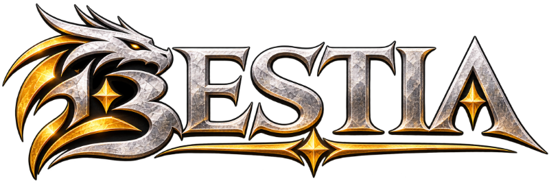

<p align="center">
  
</p>

<p align="center"><b>An open-source fantasy MMORPG built with Kotlin and Godot.</b></p>

<p align="center">
  <a href="LICENSE"></a>
  <a href="https://kotlinlang.org"></a>
  <a href="https://spring.io/projects/spring-boot"></a>
  <a href="https://godotengine.org"></a>
  <a href="https://docs.bestia-game.net"></a>
  <a href="https://github.com/tfelix/bestia-behemoth/commits/main"></a>
  <a href="https://github.com/KotlinBy/awesome-kotlin"></a>
</p>

<p align="center">
  <a href="https://docs.bestia-game.net">Documentation</a> ·
  <a href="#getting-started">Getting started</a> ·
  <a href="#contributing">Contributing</a> ·
  <a href="https://discord.gg/zZW8M2S">Discord</a> ·
  <a href="THIRD-PARTY.md">Credits</a>
</p>

> [!NOTE]
> **Pre-alpha.** The server and client are under heavy development, there is no public server and no stable
> build yet. This repository is for people who want to read, run or help build it.

<!-- TODO: add an in-game screenshot or short GIF here, e.g. <p align="center"></p> -->

## 🌍 A world torn apart

In the aftermath of the **Rift**, a cataclysmic event that merged realities and unleashed uncontrolled magic,
survivors emerge into a harsh new world. **Bestia** is a living ecosystem where your choices ripple across vast
procedurally generated landscapes spanning thousands of square kilometers. Inspired by
[Ragnarök Online](https://en.wikipedia.org/wiki/Ragnarok_Online) and
[Pokémon](https://en.wikipedia.org/wiki/Pok%C3%A9mon).

Bestia embraces emergent gameplay where player actions shape the world's destiny. Choose your path:

- **Builders** who reconstruct civilization from the ruins
- **Adventurers** exploring dangerous, magic-warped territories
- **Survivors** forging alliances in a world where cooperation means survival
- **Faction leaders** deciding whether to hasten the world's transformation or preserve what remains

The world evolves with the collective decisions of its players.

## 🧱 What is in this repository

A monorepo with everything the game needs, from server to client to world generator:

| Part | What it is |
|---|---|
| [`zone-server`](zone-server) | The game world: Netty socket, ECS game loop, owns the Valkey bus |
| [`login-server`](login-server) | Accounts, authentication and the handoff to a zone |
| [`api-server`](api-server) | JSON API for the companion app; serves the map to the client |
| [`bus`](bus), [`shared`](shared) | Inter-server communication and code shared by the servers |
| [`bnet-messages`](bnet-messages) | The protobuf wire protocol between client and servers |
| [`worldgen`](worldgen) | Procedural world generator |
| [`bestia-client`](bestia-client) | The game client, built with Godot (.NET) |
| [`companion-app`](companion-app) | Installable web app (SvelteKit) to look in on your characters |

**Built with:** Kotlin, Spring Boot, Netty, Protocol Buffers, Valkey, MariaDB, Godot (C#), SvelteKit.

## 🚀 Getting started

You need JDK 21, Docker, and for the client the [Godot 4.7 .NET build](https://godotengine.org/download) with the
matching .NET SDK. Start the servers in this order (the zone's `bootRun` brings up MariaDB and Valkey through
Docker Compose):

```bash
cd zone-server && docker compose up
./gradlew :zone-server:bootRun
./gradlew :login-server:bootRun
./gradlew :api-server:bootRun
```

Then build the client once and open it in Godot:

```bash
dotnet build "bestia-client/src/Bestia Behemoth Client.csproj"
```

Open `bestia-client/src/project.godot` in the editor. Setup details are in the
[client README](bestia-client/README.md), the web app is described in the
[companion app README](companion-app/README.md), and tests are covered in [CONTRIBUTING.md](CONTRIBUTING.md).

## 📚 Documentation

Game mechanics, server architecture and API references live at [docs.bestia-game.net](https://docs.bestia-game.net).

## 🤝 Contributing

Contributions of every size are welcome:

- **🧪 Tests**: a lot of the codebase needs more coverage, which makes a good first contribution
- **🔧 Bug fixes**: help us squash issues and improve stability
- **✨ Features**: new gameplay mechanics and systems
- **📖 Documentation**: help others understand the architecture

Read [CONTRIBUTING.md](CONTRIBUTING.md) first, and the design guidelines in the
[documentation](https://docs.bestia-game.net) before changing gameplay, so that new features fit the game's
philosophy.

## 📜 License

Everything in this repository (server, client, world generator and tooling) is licensed under the
[GNU General Public License v3.0](LICENSE). Third-party work this project builds on, and the licences it arrives
under, is listed in [THIRD-PARTY.md](THIRD-PARTY.md).

---

> *"In a world remade by chaos, only the bold will write the next chapter."*
